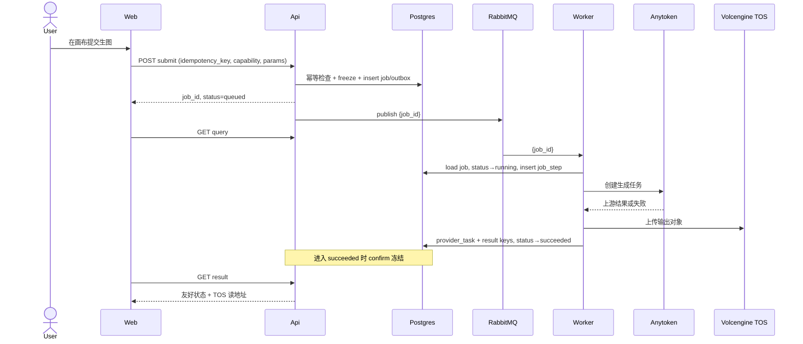
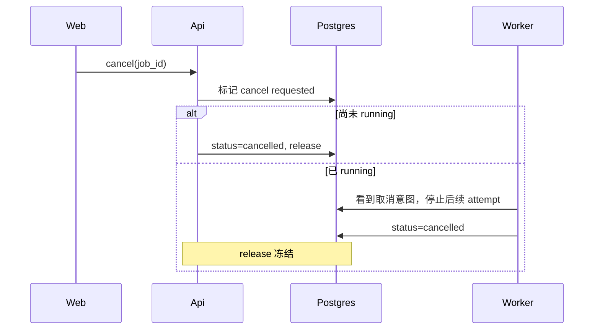

# 架构

本文描述 flora **目标架构**（M1 起）。当前仓库仍主要是 `web/` 前端。进程名、分层和时序按目标写，避免按现状倒推。

## 进程

| 进程 | 职责 | 不职责 |
| --- | --- | --- |
| **web** | C 端画布与托管 UI。托管模式只调用 flora API。静态文案走 locale。 | 不持有 Anytoken/供应商密钥；不实现钱包；不直接打上游模型。 |
| **api** | Java 21 + Spring Boot 3。认证（Sa-Token）、钱包冻结、创建 job、outbox、查询、签发 TOS 读地址、把内部错误映射成 `error_code`。 | 不在请求线程里同步跑长生成；不 fork NewAPI；不做画布渲染。 |
| **worker** | 瘦执行器。按 `job_id` 加载任务，调 Anytoken，写 `job_step` / `provider_task` / 结果键，ack 或重试或进 DLQ。 | 不读画布图；不拼节点拓扑；不 confirm/release 钱包（由 api 领域服务在状态迁移时做，或经明确的领域事件，不得散落在 worker 里复制一套账本）；不做 HTTP 面向用户的 API。 |
| **admin** | M4 才做。运维查询与配置。 | 不是第二套创作产品；不复制画布。 |

四者共享 Postgres（账本与任务）和 Redis（会话/锁/短缓存）。对象文件走火山 TOS。模型请求只经 Anytoken。

```
浏览器 (web)
    │  JSON + 会话
    ▼
flora api  ── Postgres / Redis / TOS 签名
    │  outbox → RabbitMQ (body = job_id)
    ▼
flora worker ── Anytoken ── 上游模型
    │
    ▼
写回 job_step / provider_task / TOS 对象键
```

## 分层（api）

从上到下，禁止跨层回流成上帝类。

1. **Interface**：HTTP 控制器、Sa-Token 过滤器、内部 DTO 校验。只转合同，不写业务分支。
2. **Application**：用例。例如「提交生图」= 校验幂等 → 估价 → 冻结 → 建 job → 写 outbox。一个用例一个类，避免 `TaskCenterService`。
3. **Domain**：`Job` 状态机、钱包冻结单、错误码。状态迁移函数保持纯：非法迁移直接拒绝。
4. **Infrastructure**：Postgres 仓储、Redis、RabbitMQ Transport、TOS 客户端、**唯一** Anytoken Client。

worker 只有 Application（执行一步）+ Infrastructure（队列、Anytoken、仓储）。没有 canvas 包。

## Anytoken hop

flora **不** 做模型聚合网关，只做一跳：

```
web → api（内部 DTO）→ worker → Anytoken → 上游
```

规则：

- 浏览器永不拿到 Anytoken token 或上游 Key。
- flora 用户表 / 钱包是唯一账本。Anytoken 侧若有 token 额度，那是运维成本，不映射成用户余额。
- 禁止再接 NewAPI、qfzy-api 或「临时再写一个 OpenAI 兼容代理」。供应商差异在 Anytoken 消化。
- api 给 worker 的是内部任务合同（模型名、能力、参数引用、job_id），不是把前端原始请求原样转抛。

见 [ADR 0001](./adr/0001-anytoken-not-newapi-fork.md)。

## 任务状态机

```
created → queued → running → succeeded
                ↘ failed ──(attempt < max)→ queued
                ↘ cancelled
                ↘ dead          ← 超限或不可重试，进入 DLQ
```

- MQ 消息体只有 `job_id`。worker 以数据库为准。
- `job_step` 记录每一次 attempt 的开始/结束、映射后的 `error_code`、指向 `provider_task` 的关联。
- 取消：api 标记取消意图；worker 在运行前检查；已在上游的尽量 best-effort 取消，但账本以 flora 状态为准。

## 计费与任务的交界

提交必须在同一事务里完成「冻得住才入队」：

1. 估价（可先简单规则，字段在 billing brief 定）。
2. `freeze` 成功才把 job 置 `queued` 并写 outbox。
3. 终态 `succeeded` → `confirm`。
4. 终态 `failed`（不再重试）、`cancelled`、`dead` → `release`。

worker 不直接改余额。它只推进 job；确认/释放由 api 侧领域服务在进入终态时执行（同进程方法或可靠领域事件，但代码上不得出现第二套钱包写入）。

## 时序：一次成功生图



失败时 worker 写 `provider_task` 原文、映射 `error_code`，job 回 `queued` 或进 `dead`；进入不再执行的失败终态时 release。用户查询始终不带上游原文。

## 时序：取消



## 为什么必须拆进程

qingfeng 的教训不是「Java 不行」，而是职责粘在一起：

- 一个 TaskCenter 同时懂状态、队列、画布、生产、重试。
- worker 为了「方便」去拉创作上下文，最后变成第二个业务后端。
- 两个网关适配器并存，账本对不齐。

flora 用进程边界强制：web 只展示，api 只编排账本与任务，worker 只执行一跳，admin 只看和配置。

## 目录预期（尚未全部存在）

| 路径 | 状态 | 说明 |
| --- | --- | --- |
| `web/` | 已存在 | 前端 fork |
| `api/` | 未入仓 | Spring Boot 业务 API，WP1 |
| `worker/` | 未入仓 | 瘦 worker，WP1/WP4 |
| `docs/engineering/` | 本树 | 工程真相源 |
| `docs/content/` | 已存在 | 公开用户文档，勿改作工程站 |

在 WP1 brief 落地前，不要先建空的巨型包结构。
